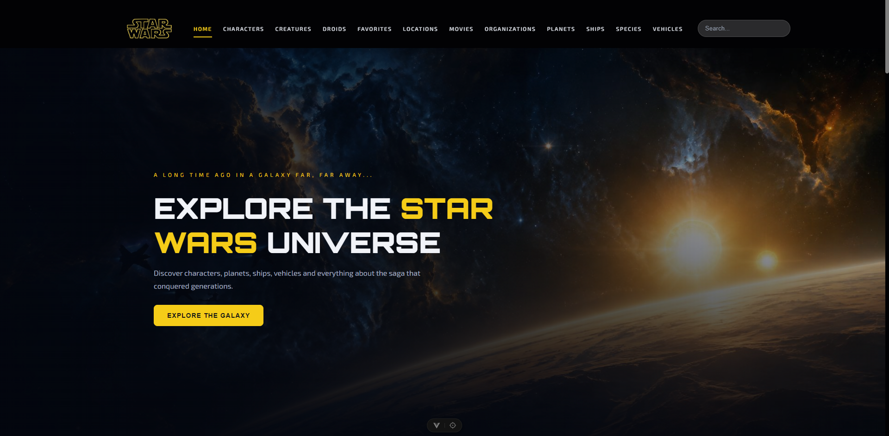

# ⭐ Star Wars Explorer

Explore the Star Wars universe! Uma aplicação web desenvolvida para reunir informações sobre personagens, filmes, planetas, espécies, naves e muito mais do universo Star Wars.

O projeto utiliza Vue.js no Front-end e Node.js com Express no Back-end, integrando diferentes APIs para combinar informações e imagens em uma experiência de navegação interativa.

🔗 **Live Demo:** https://star-wars-src.vercel.app

---

## 📸 Preview

---

## 🚀 Funcionalidades

- **Home:** página inicial com apresentação do universo Star Wars e seções de conteúdos em destaque.
- **Characters:** explore personagens do universo Star Wars.
- **Creatures:** descubra diferentes criaturas.
- **Droids:** conheça os diferentes tipos de droides.
- **Movies:** consulte informações sobre os filmes da franquia.
- **Planets:** explore os planetas e suas características.
- **Species:** descubra as espécies existentes no universo.
- **Locations:** explore diferentes localizações.
- **Organizations:** consulte organizações e grupos.
- **Starships:** conheça as naves espaciais.
- **Vehicles:** explore os veículos.
- **Favorites:** salve seus conteúdos favoritos utilizando LocalStorage.
- **Search:** pesquise conteúdos de diferentes categorias em um único campo.
- **Details Modal:** visualize informações detalhadas sobre os itens selecionados.

---

## 🛠️ Tecnologias utilizadas

### Front-end
- Vue.js 3
- JavaScript
- Vue Router
- SCSS
- Vite
- LocalStorage

### Back-end
- Node.js
- Express.js
- JavaScript
- APIs REST
- CORS

### APIs e fontes de dados
- [SWAPI](https://swapi.dev/) — informações oficiais estruturadas sobre o universo Star Wars.
- [Star Wars Databank API](https://starwars-databank-server.onrender.com/) — informações complementares e imagens de personagens e outros conteúdos.
- [Akabab Star Wars API](https://akabab.github.io/starwars-api/) — dados e imagens de personagens.

### Hospedagem e imagens
- [Vercel](https://vercel.com/) — hospedagem do Front-end e Back-end.
- [Cloudinary](https://cloudinary.com/) — armazenamento e otimização de imagens.

---

## 🧠 Integração de dados

O Back-end combina informações provenientes de diferentes fontes para disponibilizar dados mais completos ao Front-end.

Entre os recursos implementados estão:

- Normalização de dados recebidos de diferentes APIs.
- Combinação de informações utilizando identificadores e nomes.
- Resolução de relacionamentos entre entidades.
- Complementação de informações ausentes.
- Associação de imagens aos conteúdos utilizando Cloudinary.
- Tratamento de respostas e falhas das APIs externas.

Essa abordagem permite apresentar informações de diferentes fontes em uma estrutura padronizada.

---

## 📂 Estrutura do projeto

O projeto está dividido em duas aplicações independentes:

### Front-end

```text
├── src/
│   ├── assets/
│   │   ├── images/
│   │   └── scss/
│   │   └── styles/
│   ├── components/
│   │   ├── home/
│   │   ├── Footer.vue
│   │   ├── Header.vue
│   │   └── Modal.vue
│   ├── composables/
│   │   └── useFavorites.vue
│   ├── router/
│   ├── services/
│   ├── views/
│   ├── App.vue
│   └── main.js
├── .env
└── package.json
```

### Back-end

```text
backend/
├── src/
│   ├── data/
│   │   ├── content.json
│   ├── providers/
│   │   ├── swapi.js
│   │   ├── databank.js
│   │   └── akabab.js
│   ├── routes/
│   ├── services/
│   │   ├── catalog.js
│   │   ├── contentImage.js
│   │   └── mergeCharacters.js
│   └── server.js
├── index.js
└── package.json
```

---

## ⚙️ Como executar o projeto

### Pré-requisitos

- Node.js
- npm
- Git

### 1. Clone o repositório

```bash
git clone https://github.com/Vinicius-Boschi/Star-Wars.git
```

### 2. Acesse o projeto

```bash
cd Star-Wars
```

### 3. Configure o Back-end

```bash
cd backend
npm install
```

Crie um arquivo `.env` caso existam variáveis de ambiente necessárias para sua configuração.

Inicie o servidor:

```bash
npm run dev
```

### 4. Configure o Front-end

Em outro terminal, acesse a pasta do Front-end:

```bash
cd frontend
npm install
```

Configure a variável de ambiente com o endereço do Back-end:

```env
VITE_API_URL=http://localhost:3000
```

Inicie a aplicação:

```bash
npm run dev
```

A aplicação estará disponível no endereço informado pelo Vite, geralmente:

```text
http://localhost:5173
```

---

## 🌐 Endpoints da API

O Back-end disponibiliza rotas para consulta dos conteúdos do universo Star Wars.

| Método | Endpoint | Descrição |
|---|---|---|
| GET | `/characters` | Lista personagens |
| GET | `/character/:id` | Consulta um personagem |
| GET | `/movies` | Lista filmes |
| GET | `/planets` | Lista planetas |
| GET | `/species` | Lista espécies |
| GET | `/starships` | Lista naves |
| GET | `/vehicles` | Lista veículos |

---

## 🎨 Interface

A interface foi desenvolvida com foco em uma experiência visual inspirada no universo Star Wars, utilizando:

- Layout responsivo.
- Tema escuro.
- Identidade visual inspirada na franquia.
- Componentização com Vue.js.
- Animações e transições.
- Modais para visualização de detalhes.
- Navegação entre diferentes categorias.

---

## 📌 Objetivos do projeto

Este projeto foi desenvolvido com o objetivo de praticar e aprofundar conhecimentos em desenvolvimento Front-end e Back-end, trabalhando com:

- Desenvolvimento de aplicações utilizando Vue.js.
- Criação e organização de componentes reutilizáveis.
- Gerenciamento de rotas.
- Consumo e integração de múltiplas APIs.
- Desenvolvimento de uma API REST com Express.
- Manipulação e normalização de dados.
- Persistência de informações com LocalStorage.
- Organização de projetos em camadas.
- Deploy e configuração de aplicações na Vercel.

---

## 👨‍💻 Desenvolvedor

**Vinicius Boschi**

- GitHub: [Vinicius-Boschi](https://github.com/Vinicius-Boschi)

---

*May the Force be with you! ✨*